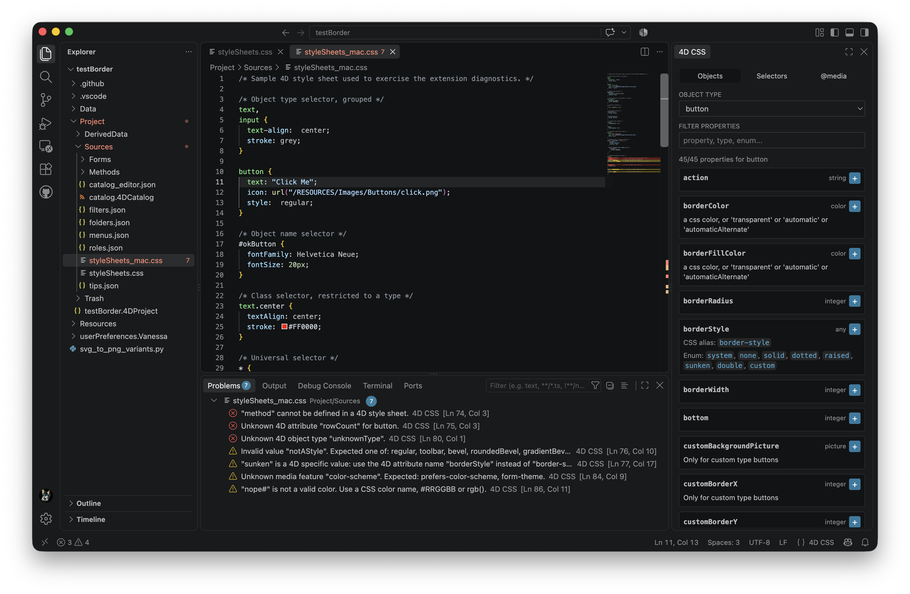

# 4D Form & CSS Language Support for VS Code

Editing support for 4D form style sheets and `.4DForm` files, driven by the 4D Forms JSON Schema and
the [4D style sheets documentation](https://developer.4d.com/docs/FormEditor/stylesheets).

## Preview

## Getting started

1. Install the extension from the
   [VS Code Marketplace](https://marketplace.visualstudio.com/items?itemName=vanessa-talbot.4d-css-language-support).
2. Open a 4D project folder: `.4DForm` files and `styleSheets*.css` / `.4dcss` files are recognized
   automatically.
3. Open the **4D CSS** view in the activity bar to browse the reference.

## Features

- `4d-css` language mode for `.4dcss` files and for `styleSheets.css`, `styleSheets_mac.css`, `styleSheets_windows.css`
- syntax highlighting (selectors, attributes, `url()`, `rgb()`, `!important`, media features)
- attribute and value completion scoped to the object type(s) of the current selector
- hover documentation built from the schema `$comment` / `description`
- **4D CSS: Reference** view with schema-driven object properties, selector reference and `@media`
  reference. The object property list follows the current selector automatically and can insert
  properties at the cursor; `@media` entries can insert a media block.
- diagnostics
- `.4DForm` files are validated against the same JSON Schema: VS Code's built-in JSON support gives
  base schema validation, and the extension adds 4D-specific checks (see [Diagnostics](#diagnostics))
  plus property and enum-value completion (also triggered by <kbd>Space</kbd>, like the CSS side)

### Supported selectors

| Selector | Example |
| --- | --- |
| object type | `button { ... }`, `text, input { ... }` |
| object name | `#okButton { ... }` |
| class | `.okButtons { ... }`, `text.center { ... }` |
| all objects | `* { ... }` |
| attribute | `[borderStyle]`, `[text=Hello]`, `[text~=Hello]`, `[text\|=Hello]` |

Listbox inner objects `column`, `header` and `footer` are handled as object types.

### Supported declarations

- 4D JSON attribute names (from the schema)
- CSS aliases: `border-style`, `background-color`, `font-family`, `font-size`, `font-style`,
  `font-weight`, `color`, `text-align`, `text-decoration`, `vertical-align`
- `!important`
- `url()` for `icon`, `picture`, `customBackgroundPicture`
- colors as CSS name, `#RRGGBB` or `rgb()`
- `@media (prefers-color-scheme: light|dark)` and
  `@media (form-theme: fluent-ui|win-classic|liquid-glass|mac-classic)`, including nesting

## Diagnostics

Open files are validated as you type. `.4DForm` files and 4D style sheets created or modified on
disk without an editor (generated by a script or an AI agent, for example) are validated too, and
their problems stay in the Problems panel until the file is deleted. AI agents running in VS Code,
such as Claude Code, can read them back with their diagnostics tool. Set `4dCss.validateOnDiskChange`
to `false` to turn this off.

### Style sheets

- attributes that can never be set from a style sheet: `method`, `type`, `class`, `event`,
  `choiceList`, `excludedList`, `labels`, `list`, `requiredList`
- unknown attributes, or attributes not supported by the selected object type
- invalid enum values, numbers, booleans, colors and formats (`dateFormat`, `timeFormat`, heights)
- 4D specific values used with a CSS attribute name (e.g. `border-style: sunken`)
- unknown object types, invalid attribute selectors and unsupported operators
- unknown media features/values and unsupported at-rules
- `left`, `top`, `width` and `height` declared without `!important` (warning, with a quick fix adding
  `!important` to one declaration or to all of the file). The 4D form editor writes these coordinates
  in the form JSON for every object, and writes them again on save if they were removed by hand: as
  form attributes win over style sheets, only an `!important` value applies

### Forms (`.4DForm`)

- unknown attributes, with a "did you mean" suggestion
- unknown object types
- invalid enum values, colors, numbers, booleans and formats
- `$ref` values (e.g. `/SOURCES/tips.json#/Tip`) whose file or JSON pointer cannot be resolved, or
  whose target value is invalid for the attribute
- CSS classes of the `class` attribute (objects, listbox columns, headers and footers) not declared
  in any style sheet loaded by the form, with a "did you mean" suggestion for typos. The style
  sheets taken into account are `/SOURCES/styleSheets.css`, `styleSheets_mac.css`,
  `styleSheets_windows.css` and the ones listed in the form `css` attribute
- paths of the form `css` attribute that do not lead to any file (relative to the form folder, or
  starting with `/RESOURCES/` or `/SOURCES/`)
- picture paths of the `icon`, `customBackgroundPicture` and `picture` attributes (objects, listbox
  headers, tree items) that do not lead to any file, resolved the same way; `var:` values are skipped
- style cascade (information level, with a quick fix removing the attribute from the form):
  - an attribute written in the form JSON that overrides a style sheet declaration targeting the
    object. As in the CSS 2.1 cascade, form attributes act like an inline `style` attribute: they win
    over every rule that is not `!important`, whatever its specificity, even with a default value
    such as `"stroke": "automatic"`
  - an attribute written on a listbox column, header or footer that prevents it from inheriting the
    value its listbox gets from a style sheet (`fontFamily`, `fontTheme`, `fontSize`, `stroke`,
    `textAlign`, `verticalAlign`, `fontWeight`, `fontStyle`, `textDecoration`)
  - a `left`, `top`, `width` or `height` of the form hiding a style sheet value. Removing it from
    the form is not offered, since the form editor writes it again: the quick fix declares the style
    sheet value `!important` instead
  - a `fontTheme` set next to a `fontFamily` in the form, where `fontFamily` wins. Both set the font
    and compete as a single attribute: a `fontFamily` in the form also overrides a `fontTheme` from a
    style sheet, and the other way round

  - an attribute that only repeats the style sheet value (or the value the listbox gets from a style
    sheet): nothing shows today, but later changes to the style sheet would not apply. Values are
    compared after normalization (`18` and `18px`, `#e65100`, `#E65100` and `rgb(230, 81, 0)`), and an
    attribute counts as a duplicate only when every declaration it hides has the same value and one
    of them applies on every platform and outside any `@media` block, so that removing it changes
    nothing. A quick fix removes all the duplicates of the form at once

  The message names the rule and links to it, including its `@media` block or platform if any.
  Selectors made of a single compound (type, `#name`, `.class`, attribute) are taken into account.

Style sheet checks on forms need a 4D project layout (`<project>/Project/Sources/...`); they are
skipped for a standalone `.4DForm` that loads no style sheet.

## Schema

`schema/formsSchema.json` is the source of truth. The bundled schema matches **4D 21 R5**.

Use the `4dCss.schemaPath` setting to point to another schema (absolute path, or relative to the
first workspace folder), then run **4D CSS: Reload Schema**.

## Commands

- **4D CSS: Show Reference** — opens the interactive reference view for object properties, selectors
  and `@media` features.
- **4D CSS: Reload Schema** — reloads the JSON Schema and revalidates the open documents.
- **4D CSS: Validate All Form and Style Sheet Files** — validates every `.4DForm`, `.4dcss` and
  `styleSheets*.css` file of the workspace, including files that are not open.

## Contributing

See [CONTRIBUTING.md](CONTRIBUTING.md) for the source layout and build instructions.
